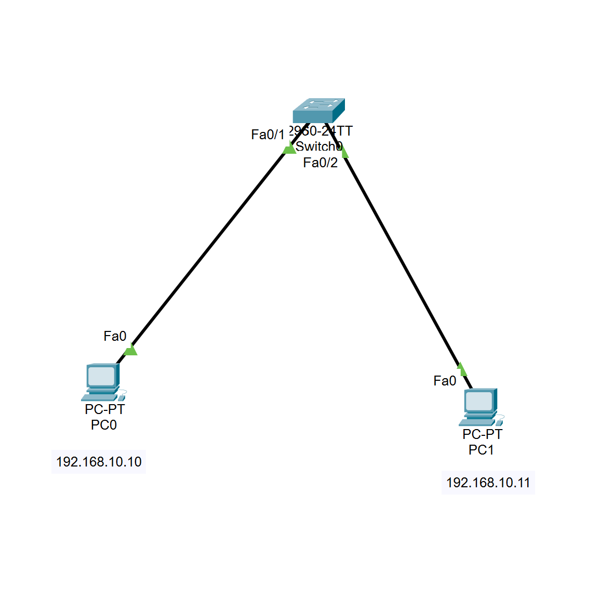
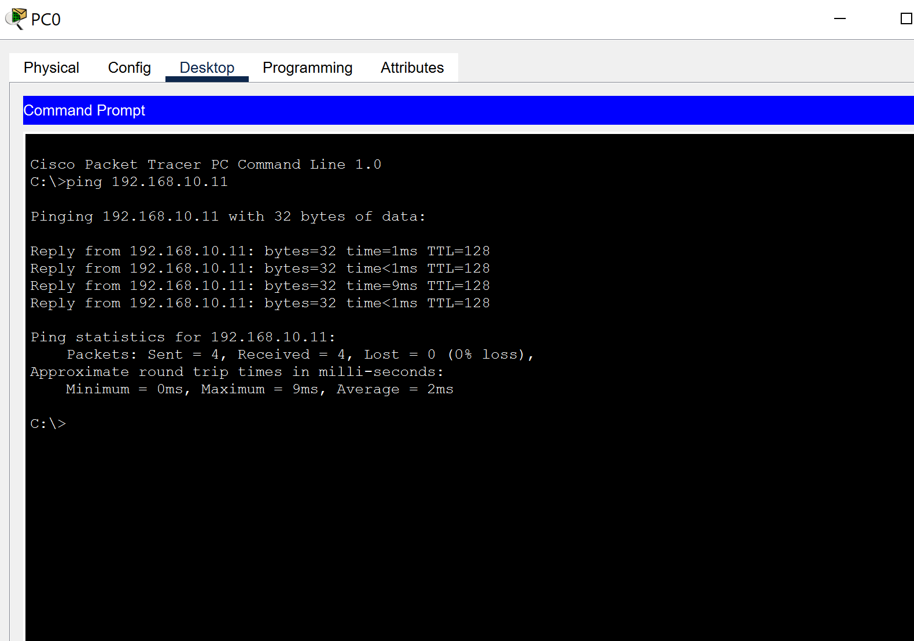
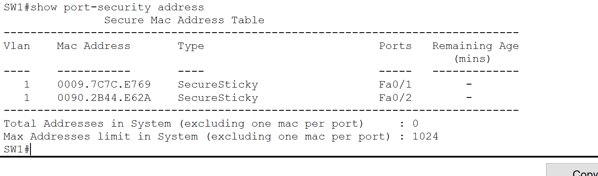
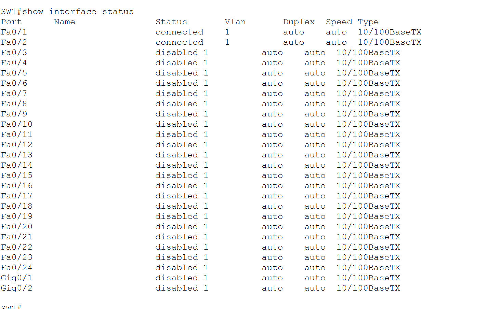

# Secure Small Office LAN — Cisco Packet Tracer

## Overview

This project demonstrates the configuration and basic security hardening of a small office Local Area Network (LAN) using Cisco Packet Tracer and a Cisco Catalyst 2960 switch.

The lab focuses on basic switch configuration, end-device connectivity, MAC address learning, and Layer 2 access-port security.

## Objectives

- Configure a Cisco switch using the IOS CLI.
- Establish connectivity between two PCs on the same subnet.
- Configure basic device access protections.
- Implement Port Security with sticky MAC address learning.
- Restrict unauthorized source MAC addresses using the `restrict` violation mode.
- Disable unused switch ports.
- Verify configurations and connectivity using Cisco IOS commands.

## Lab Topology

**Devices:**
- 1 × Cisco Catalyst 2960 switch (`SW1`)
- 2 × PCs (`PC0` and `PC1`)
- Ethernet connections between each PC and the switch

### Network Addressing

| Device | Switch Port | IP Address | Subnet Mask |
|---|---|---|---|
| PC0 | Fa0/1 | 192.168.10.10 | 255.255.255.0 |
| PC1 | Fa0/2 | 192.168.10.11 | 255.255.255.0 |

Both PCs belong to the same IPv4 subnet. A default gateway is not required for communication between these two devices on the same LAN.

## Configuration and Security Controls

### 1. Basic Switch Hardening

Configured the following controls:

- Set the switch hostname to `SW1`.
- Configured an enable secret.
- Enabled password obfuscation using `service password-encryption`.
- Added a Message of the Day (MOTD) banner.
- Configured a console password and login requirement.
- Set an inactivity timeout for the console session.

**Security note:** `service password-encryption` provides weak password obfuscation and should not be treated as strong encryption.

### 2. Port Security

Configured Port Security on access ports `Fa0/1` and `Fa0/2`.

The configuration includes:

- Access mode on each endpoint port.
- Port Security enabled.
- Maximum of one secure MAC address per port.
- Sticky MAC address learning.
- Violation mode set to `restrict`.

Example configuration:

```text
interface FastEthernet0/1
 switchport mode access
 switchport port-security
 switchport port-security maximum 1
 switchport port-security mac-address sticky
 switchport port-security violation restrict
```

The same policy was applied to `FastEthernet0/2`.

Sticky MAC learning allows the switch to learn a source MAC address and add it to the running configuration. The configuration must be saved to startup configuration to preserve the learned settings across a restart.

### 3. Unused Port Shutdown

Unused switch ports were administratively disabled to reduce the risk of unauthorized devices being connected to available access ports.

## Verification

The following checks were performed:

| Test | Result |
|---|---|
| PC0-to-PC1 connectivity using `ping` before Port Security | Passed |
| MAC address table inspection | Expected endpoint MAC addresses were learned on the connected ports |
| Port Security status on Fa0/1 and Fa0/2 | Enabled; both ports reported `Secure-up` |
| Secure MAC address table | One sticky secure MAC address was listed per endpoint port |
| Security violation counter during inspection | 0 on both ports |
| Configuration save | Confirmed by the operator |
| Connectivity after Port Security | Passed, as confirmed during lab testing |
| Unused port shutdown | Configured; final port status should be verified in the saved lab |

## Useful Verification Commands

```text
show running-config
show startup-config
show mac address-table
show port-security
show port-security interface fastEthernet 0/1
show port-security interface fastEthernet 0/2
show port-security address
show interfaces status
```

## Limitations

- This is a small, simulated Layer 2 LAN, not a production enterprise network.
- Port Security is one defense-in-depth control and does not replace VLAN segmentation, network access control, monitoring, or broader security policies.
- The lab does not yet include a router, inter-VLAN routing, centralized logging, or SIEM integration.
- The `enable secret` algorithm and available security features depend on the simulated IOS version.

## Lab Evidence

### 1. Network Topology

The topology consists of one Cisco Catalyst 2960 switch and two PCs connected through access ports.



### 2. Connectivity Verification

PC0 successfully pinged PC1 at `192.168.10.11`. Four packets were received with zero packet loss.



### 3. Port Security Verification

The secure MAC address table shows one sticky secure MAC address learned on each endpoint port.



### 4. Unused Port Shutdown

Unused FastEthernet and GigabitEthernet ports were administratively disabled, while the two endpoint ports remained connected.




## Skills Practiced

- Cisco IOS CLI configuration
- IPv4 addressing and subnetting fundamentals
- Ethernet switching and MAC address learning
- Basic switch hardening
- Layer 2 Port Security
- Network connectivity troubleshooting
- Configuration verification and technical documentation

## Project Files

- `README.md` — Project documentation
- `.pkt` file — Cisco Packet Tracer lab file
- `screenshots/` — Evidence of topology, configuration, and verification

## Future Improvements

- Implement VLAN segmentation.
- Configure dedicated management access.
- Explore secure remote administration where supported by the lab.
- Introduce Access Control Lists (ACLs) in a later routing lab.
- Expand network monitoring and security validation.


